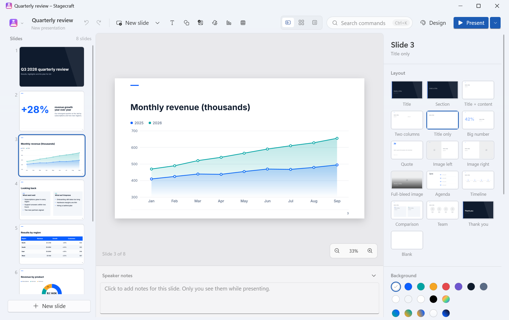
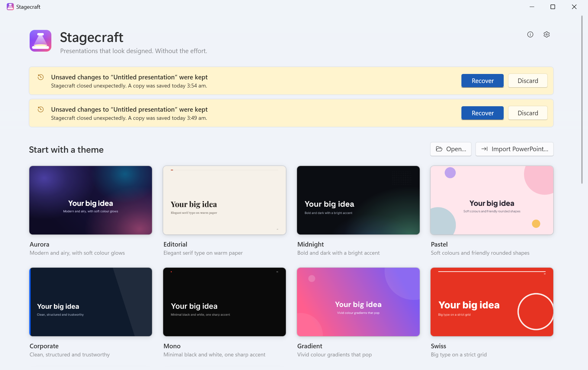
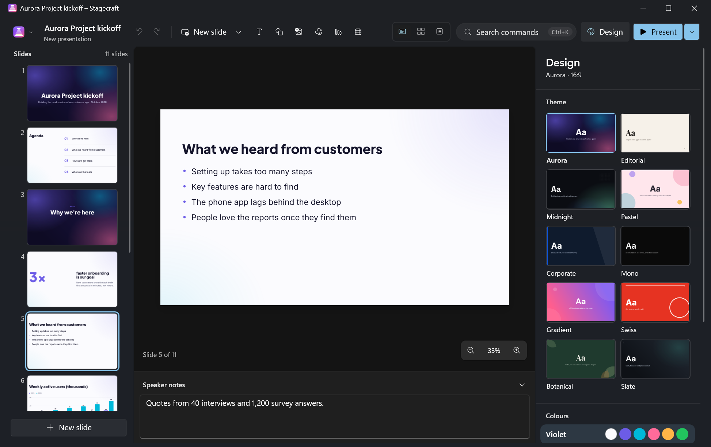
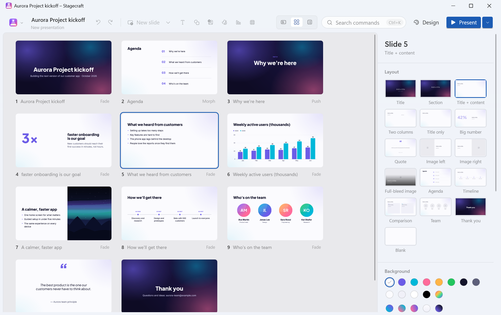
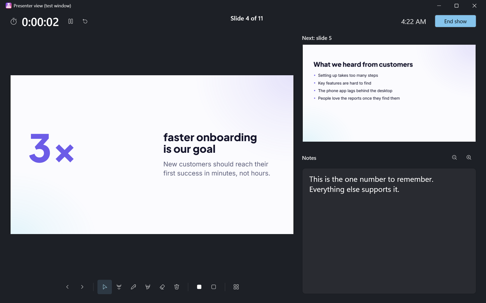
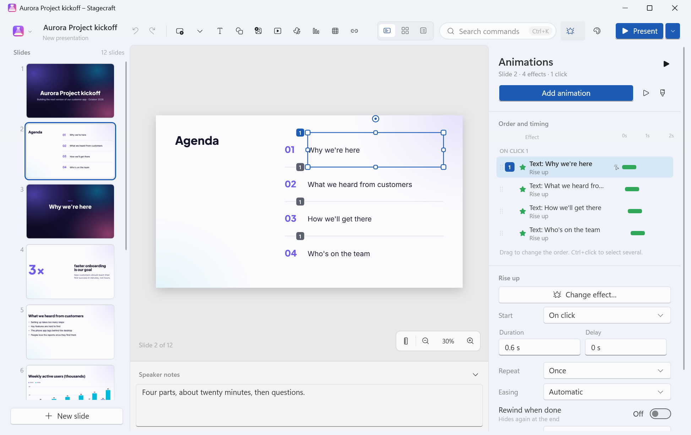
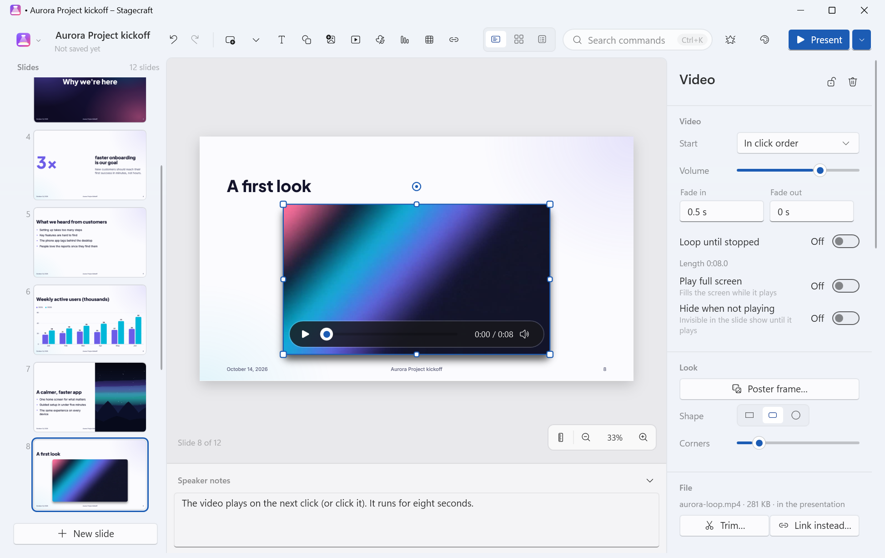

<p align="center"></p>

# Stagecraft

**Presentations that look designed. Without the effort.**

Stagecraft is a free presentation app for Windows. Pick a theme, type your talk, and every slide comes out well designed: balanced layouts, real typography, soft colour, and smooth Morph transitions. When it's time to present, the presenter view shows your notes, the next slide and a timer while the audience sees only the slides.



| | |
|---|---|
|  |  |
|  |  |

## What's new in 1.1

| | |
|---|---|
|  |  |

**Animations**
- Entrance effects: Appear, Fade, Fly in (from eight directions), Float in, Wipe, Split, Zoom, Grow & turn, Bounce, Wheel, Swivel and Rise up. Exit effects are their mirror images (Disappear, Fade out, Fly out, Sink down…).
- Emphasis effects: Pulse, Spin (choose the angle), Grow / shrink (choose the size), Teeter, Colour pulse, Transparency, Bold flash and Wave.
- Motion paths: line, arc, circle, or draw your own. A selected path shows on the slide; drag its points to reshape it.
- Timing for every effect: On click, With previous or After previous; duration and delay; repeat a number of times or until the next click or the end of the slide; rewind when done; easing (steady, speed up, slow down, smooth, overshoot). Text can animate all at once, by paragraph (together or one click each), by word or by letter.
- Triggers: an effect can start when a particular element is clicked in the show.
- The animation pane lists the effects in order, grouped by click, with icons for their kind and start, a timeline of when each runs, drag-and-drop reordering, multi-select and **Play from here**. **Add animation** opens a gallery that previews each effect on the slide when you point at it; while the pane is open, numbered badges on the slide show which click brings each element; the animation painter (Alt+Shift+C) copies one element's animation to another.
- In the show, each click (or →, Space, a clicker) plays the next group of effects and ← goes back a step; the presenter view shows which click you're on and what comes next. Morph and the other transitions work as before.
- Presentations made with Stagecraft 1.0 open with their builds turned into the matching animations (see [the format](#the-stagecraft-format)).

**Links**
- On words, shapes, pictures, icons and **action buttons** (Back, Next, First, Last, Return to the last slide viewed, or a link of your own).
- To a web page (http and https only), an e-mail address (with a subject), a slide (next, previous, first, last, last viewed or a particular slide) or a file. Insert link is Ctrl+Shift+K (also in the right-click menu, the panel and the command palette); a ScreenTip can explain where it goes.
- Linked text is underlined in the theme's link colour. In the editor, Ctrl+click follows a link.
- In the show: a hand pointer and the ScreenTip over links; slide links jump straight to the slide; web pages and e-mail open in your browser and mail app. Files open in their app after you confirm, and programs and scripts (.exe, .bat, .ps1, .js, .msi…) are never opened from a link.

**Video and sound**
- Insert video (MP4 with H.264 / AAC is the safest choice; MOV, WMV and other formats work when Windows can play them) and sound (MP3, M4A / AAC, WAV, WMA) from a file or by dragging it onto the slide. Playback uses Windows' own media support, so nothing extra is installed.
- Media are stored inside the presentation. For files over 200 MB Stagecraft offers to link to the file instead (kept next to the presentation, relative where possible), and you can switch between linked and embedded later.
- Video: a poster frame you choose, trimming with a preview, start in the click order, automatically or when clicked, full screen, loop, volume, fade in and out, hide when not playing, rounded corners, circle shape and a border in the theme's style.
- Sound: a speaker icon (which can be hidden), play across several slides, loop, volume, fades, and the same start choices.
- Point at a video or sound in the editor for a slim playback bar; in the show the bar has play / pause, a seek bar and mute. Play, pause and stop can also be steps in the animation order.
- Online video: paste a YouTube, Vimeo or other video address to get a card that opens the video in your browser in the show. Its picture and title can be downloaded once (optional).
- Files Windows can't play get a clear message suggesting MP4 (H.264 / AAC). On Windows N editions, install Microsoft's Media Feature Pack for video and sound to play.

**More editing**
- **Header and footer**: slide numbers, a date (updated automatically or fixed) and footer text along the bottom of every slide, in the theme's style, optionally not on title slides. They're in PDF and PowerPoint exports too.
- **Find and replace** (Ctrl+F / Ctrl+H) across the whole presentation: slide text, tables and speaker notes, with match case and whole words.
- **Spell check** as you type in slide text and speaker notes, using Windows' spell checker for your keyboard's language, with suggestions on right-click (Settings › Check spelling as I type).
- **Pictures**: crop with handles (drag the edges and corners, or move the picture inside the frame), crop to a circle or rounded rectangle, opacity, border, shadow and Replace picture.
- **Styling**: your own gradients (linear or radial, two colours, any angle), shadows (soft, lifted, close, glow) on shapes, pictures, icons and text boxes, a shadow behind text, and solid, dashed, dotted, long-dash and dash-dot outlines.
- **Rulers, gridlines and guides**: rulers in centimetres or inches, gridlines with a choice of spacing, snap to grid, and guides you drag out of the rulers (drag one off the slide to remove it). Smart guides keep working alongside them.
- **Save automatically**: a presentation that has a file is saved a few seconds after you stop editing (Settings › Save automatically, on by default). New presentations aren't saved until you choose where; recovery copies of unsaved work are still kept separately.
- Importing a PowerPoint file now ends with a short list of anything that couldn't be brought over exactly.

## Features

**Beautiful by default**
- 10 designer themes (Aurora, Editorial, Midnight, Pastel, Corporate, Mono, Gradient, Swiss, Botanical, Slate), each with three colour variants, its own font pairing, backgrounds and decorations. Switching theme re-lays every slide and keeps your words.
- 16 smart layouts: Title, Section, Title + content, Two columns, Title only, Big number, Quote, Image left, Image right, Full-bleed image, Agenda, Timeline, Comparison, Team, Thank you and Blank. Change a slide's layout at any time; its title, text and pictures move along.
- Text that fits: long text shrinks to fit its box (it can be turned off per box), and titles wrap into balanced lines instead of leaving one word on its own.
- Smart guides while you move and resize: edges, centres, the slide's centre and margins, and equal spacing between neighbours. **Tidy up** (Ctrl+Alt+T) turns a messy selection into a neat row, column or grid.
- Bundled open-source fonts (Inter, Plus Jakarta Sans, DM Sans, Space Grotesk, Playfair Display, DM Serif Display, Source Serif 4, JetBrains Mono), so decks look the same on every PC. They're used by Stagecraft only and never installed into Windows.

**Fast editing**
- Command palette (Ctrl+K): every command, layout, theme, transition and slide, searchable.
- Text boxes with rich text: bold, italic, underline, size, colour, alignment, bullet and numbered lists with indents, line spacing.
- Shapes: rectangle, rounded rectangle, ellipse, triangle, diamond, line, arrow, callout and connectors that stay attached when you move things.
- Pictures: insert, drag and drop from Explorer or a browser, or paste. Crop, fill / fit, circle and rounded masks, focus point, alt text. Drop a picture on an image placeholder to fill it.
- Charts (bar, line, pie, donut) from a small data grid; paste rows straight from a spreadsheet.
- Tables with header row, banding and a bold first column.
- 1,112 icons (Fluent UI System Icons), searchable, in the theme's colours, with optional circle or rounded-square backgrounds.
- Undo and redo for everything, multi-select, group / ungroup, align and distribute, bring forward / send backward, lock, duplicate (Ctrl+D), copy and paste between slides and between decks, copy style / paste style (Ctrl+Alt+C / Ctrl+Alt+V), nudging with the arrow keys (Shift = bigger steps).
- Slide rail with drag-to-reorder and sections; a slide sorter (Ctrl+2) with sections, hide, duplicate and drag-and-drop; an outline view (Ctrl+3) to type a whole talk as titles and points.
- Speaker notes under every slide; zoom, fit and pan.
- 16:9 (default), 4:3 or a custom slide size.

**Smooth animation**
- Transitions: Fade, Push, Slide over, Zoom and **Morph**. Morph matches the same object on two slides (a duplicated slide keeps each object's identity; otherwise matching names, same content or the same layout slot) and glides position, size, rotation, opacity, colour and corner radius; text that changes cross-fades.
- Animations (entrance, emphasis, exit, motion paths, media; see above), previewable in the editor.
- Transitions and animations are eased and drawn by the GPU at the display's frame rate.

**Presenting**
- With two displays: the slides on the second screen, the presenter view on yours (current and next slide, notes with adjustable size, elapsed time and clock, slide grid).
- Laser pointer, pen and highlighter (ink is kept per slide), black and white screens (B / W), jump to a slide by typing its number and Enter, arrow keys, Page Up / Page Down, Space and presentation clickers. Esc ends.
- Rehearse timings: records how long you spend on each slide.
- The display stays on while you present.

**Safe with your work**
- Saving writes a complete new file and checks it before replacing the old one, so a crash or a full disk can't leave a half-written presentation. Saving automatically (on by default for presentations that have a file) works the same way.
- A recovery copy of unsaved work every few minutes (Settings); if Stagecraft closes unexpectedly, the start screen offers it back.
- Start screen with themes, three sample decks (also in [`samples/`](samples)) and your recent presentations with thumbnails.

## The .stagecraft format
A `.stagecraft` file is a ZIP archive:
- `mimetype` (stored first): `application/vnd.stagecraft.deck+zip`
- `deck.json`: the whole deck as readable JSON, with a `schemaVersion` (2 since Stagecraft 1.1). Older versions are upgraded when opened: a 1.0 file's builds become animations (appear, fade, rise, wipe and scale become Appear, Fade, Rise up, Wipe and Zoom, in the same order and with the same delays). Files from a newer Stagecraft are refused with a clear message instead of being misread.
- `media/`: the pictures, videos and sounds, each stored once and named by the SHA-256 of its bytes; only media the deck uses are saved. Videos and sounds are stored without recompressing them. A linked video or sound isn't in the file: the deck keeps its path relative to the presentation (and the full path as a fallback).
- `thumbs/`: `cover.png` (shown on the start screen) and a small JPEG per slide.

## Import and export
| | What you get | Limits |
|---|---|---|
| **PDF** | One page per slide at the slide's size. Vector pages: text, shapes and gradients stay sharp at any zoom, pictures are embedded, and the text can be selected and searched (the words are drawn as outlines with an invisible text layer on top). Or "Pictures": each page is a high-resolution image. Links are clickable: web pages and e-mail, links to slides (they go to that page), links to files, and the file of a linked video or sound. Header and footer are on the pages. | Soft glows and see-through gradients are embedded as high-resolution pictures inside the vector page. Videos show their poster frame (or a video card when there is none). "Last slide viewed" links have no PDF equivalent. |
| **PNG / JPG** | The current slide or every slide (into a folder) at 1920, 2560 or 3840 pixels wide. Videos show their poster frame (or a video card). | |
| **PowerPoint export (.pptx)** | Text boxes, shapes, lines, pictures and tables as native, editable PowerPoint objects; slide size, speaker notes, hidden slides, transitions (Fade, Push, Slide, Zoom), animations, links, videos and sounds, and the header and footer (as text boxes, the slide number as a PowerPoint field). The engine tests check the files against the Office Open XML schema; the exporter itself doesn't run that check. | Charts, icons, action buttons and online video cards become pictures (keeping their links). Morph becomes a fade. Fonts that aren't installed on the other PC are replaced by PowerPoint. See the table below for animations. |
| **PowerPoint import (.pptx)** | Slide size, text with basic formatting (sizes, bold, italic, underline, colours, fonts, alignment, bullets), shapes (rectangles, rounded rectangles, ellipses, triangles, diamonds, callouts, action buttons; others as rectangles), lines and connectors with arrowheads, pictures with cropping, groups, tables, bar / line / pie / doughnut charts (from their saved data), slide backgrounds, speaker notes, hidden slides, transitions, hyperlinks (web, e-mail, slides, files), embedded and linked videos and sounds with their trim, fades, volume and looping, and animations. Opening a .pptx imports a copy; the original isn't changed. | SmartArt, other chart types, ink and embedded objects are left out; animation effects Stagecraft doesn't have become the closest one. After importing, Stagecraft lists what it left out or changed. Master and layout inheritance is only followed for positions, text styles and backgrounds, so some decks need touching up. EMF / WMF pictures aren't shown. |

**Animations in PowerPoint files**
| Stagecraft | Exported to PowerPoint as | Imported from PowerPoint |
|---|---|---|
| Appear, Fade, Fly in / out (8 directions), Wipe (4 directions), Split (4 directions), Wheel, Zoom | the same effect | the same effect |
| Float in, Rise up, Swivel | Fade | Float in (also Float down), Rise up, Swivel |
| Bounce | Fly in from the top | Bounce |
| Grow & turn | Zoom | Grow & turn |
| Spin (angle), Grow / shrink (size), Transparency (amount) | the same effect | the same effect |
| Pulse, Teeter, Wave, Colour pulse, Bold flash | Pulse | Pulse, Teeter, Wave, Bold flash |
| Motion paths (line, arc, circle, custom) | a custom path of the same shape | line or custom path |
| Play, pause and stop of a video or sound | the same media action | the same media action |
| On click / With previous / After previous, delay, duration, repeat (count, until next click), rewind, easing, triggers, text by paragraph (together or one click each), by word, by letter | written as PowerPoint timing | read back |
| Other PowerPoint effects | | the closest Stagecraft effect (Fade or Pulse), and counted in the list shown after importing |

The command line can export without opening a window: `Stagecraft.exe --export-pdf deck.stagecraft deck.pdf`.

**Not in 1.1:** exporting a presentation as a video (MP4) is planned for a later version.

## Download
| Windows version | Installer | Size |
|---|---|---|
| Windows 10 / 11 (64-bit) | [Stagecraft-Setup-1.1.0-x64.exe](release/Stagecraft-Setup-1.1.0-x64.exe) | 48.6 MB |
| Windows 10 / 11 on ARM | [Stagecraft-Setup-1.1.0-arm64.exe](release/Stagecraft-Setup-1.1.0-arm64.exe) | 43.1 MB |
| Windows 10 (32-bit) | [Stagecraft-Setup-1.1.0-x86.exe](release/Stagecraft-Setup-1.1.0-x86.exe) | 44.6 MB |
| Windows 7 SP1 / 8.1 | [Stagecraft-Setup-1.1.0-win7-8.exe](release/Stagecraft-Setup-1.1.0-win7-8.exe) | 6.6 MB |

Sizes are in megabytes (1 MB = 1,000,000 bytes). SHA-256 checksums are in [release/SHA256SUMS.txt](release/SHA256SUMS.txt). The Windows 10 / 11 editions include everything they need. The Windows 7 / 8.1 edition needs Microsoft .NET Framework 4.8 (the installer checks and links to Microsoft's download).

Setup installs for all users by default; choose "Install for me only" if you don't have administrator rights. It can open `.stagecraft` files with Stagecraft and add Stagecraft to "Open with" for PowerPoint files.

**Windows SmartScreen:** the installers aren't code-signed yet, so Windows may show "Windows protected your PC" the first time. Click **More info**, then **Run anyway**. You can check the download against `SHA256SUMS.txt` first.

**Not tested yet:** ARM64 hardware (the ARM64 edition is built but hasn't run on a real ARM PC), real Windows 7 / 8.1 and 32-bit Windows 10 PCs (those editions were tested on 64-bit Windows 11), and a slide show on a real second display (it was tested in the windowed test mode). Video and sound playback depends on what Windows can play: it was checked with MP4 (H.264 / AAC), MP3, M4A and WAV files on Windows 11; MOV, WMV and WMA, Windows 7 / 8.1 and Windows N editions weren't tested. Spell checking depends on the spelling languages installed in Windows.

## Updates
Stagecraft checks for a new version about 10 seconds after it starts and then at most once a day. When there is one, it offers **Update now**, **Later** or **Skip this version**. Update now downloads the installer for your edition, checks its size and SHA-256 checksum, installs it quietly and starts Stagecraft again. You can turn the check off in Settings.

## Privacy
Stagecraft works offline. It makes network requests in two cases only:
- The update check: once a day it downloads a small file (`https://www.nomanshafiq.com/updates/stagecraft.json`) to see whether there is a new version (Settings can turn it off).
- When you insert an online video and leave "Download the video's picture and title" on: it asks the video site once for that video's picture and title (YouTube's and Vimeo's public oEmbed pages and YouTube's thumbnail server). Turn the option off and nothing is downloaded.

Opening a link in a slide show opens it in your browser or mail app. Nothing about you or your presentations is sent, and there is no telemetry. Settings and recent files are stored in `%APPDATA%\Stagecraft`; videos and sounds of open presentations are unpacked to `%TEMP%\Stagecraft-media` while Stagecraft runs and removed when it closes.

## Keyboard
| Keys | |
|---|---|
| Ctrl+K | Command palette |
| Ctrl+F / Ctrl+H | Find / find and replace |
| Ctrl+Shift+K | Insert or edit a link (Ctrl+click follows one) |
| Alt+Shift+C | Copy animation (animation painter) |
| Shift+F9 | Gridlines |
| Ctrl+M | New slide |
| Ctrl+D / Ctrl+Shift+D | Duplicate the selection / the slide |
| Ctrl+Alt+T | Tidy up |
| Ctrl+G / Ctrl+Shift+G | Group / ungroup |
| Ctrl+1 / 2 / 3 | Editor / slide sorter / outline |
| Ctrl+Shift+E | Export |
| F5 / Shift+F5 / Alt+F5 | Present from the start / from this slide / presenter view on this screen |
| In the show | → Space PageDown next (the next click of animations, then the next slide), ← PageUp previous, number + Enter jump, B / W black / white, Ctrl+L laser, Ctrl+P pen, Ctrl+I highlighter, E clear ink, Esc end |

## Building
Requirements: Windows, the [.NET 10 SDK](https://dot.net) and [Inno Setup 6](https://jrsoftware.org/isdl.php) for the installers.

```powershell
powershell -ExecutionPolicy Bypass -File build.ps1                 # tests, every edition, installers
powershell -ExecutionPolicy Bypass -File build.ps1 -Editions x64   # one edition
dotnet test tests\Stagecraft.Tests                                  # the engine tests (.NET 10 and .NET Framework 4.8)
```

Output: `dist\Stagecraft-Setup-<version>-<edition>.exe` and `dist\SHA256SUMS.txt` (copied to `release\` when every edition is built).

The code is one C#/WPF codebase for .NET 10 (Windows 10 / 11, self-contained) and .NET Framework 4.8 (Windows 7 / 8.1):
- `src/Stagecraft.Core`: the deck model, the .stagecraft format, themes and layouts, the slide renderer, snapping / tidy / Morph maths, and PDF, picture and PowerPoint import / export.
- `src/Stagecraft`: the app (editor, slide show, presenter view, dialogs).
- `tests/Stagecraft.Tests`: xUnit tests of the engine.
- `tools/`: scripts that download and verify the fonts (`get-fonts.ps1`), generate the icon geometry from Fluent UI System Icons (`make-icons.mjs`), render the app icons (`make-icon.ps1`) and generate the sample decks' video and music and the test media with ffmpeg's built-in generators (`make-sample-media.ps1`).

## Credits
- Fonts: Inter, Plus Jakarta Sans, DM Sans, Space Grotesk, Playfair Display, DM Serif Display, Source Serif 4 and JetBrains Mono, under the SIL Open Font License 1.1.
- Icons: [Fluent UI System Icons](https://github.com/microsoft/fluentui-system-icons) by Microsoft (MIT).
- [Open XML SDK](https://github.com/dotnet/Open-XML-SDK) (MIT) for PowerPoint files and [PDFsharp](https://www.pdfsharp.com) (MIT) for PDF export.

Full licence texts are in [THIRD-PARTY-NOTICES.txt](THIRD-PARTY-NOTICES.txt) and in Stagecraft's About box.
